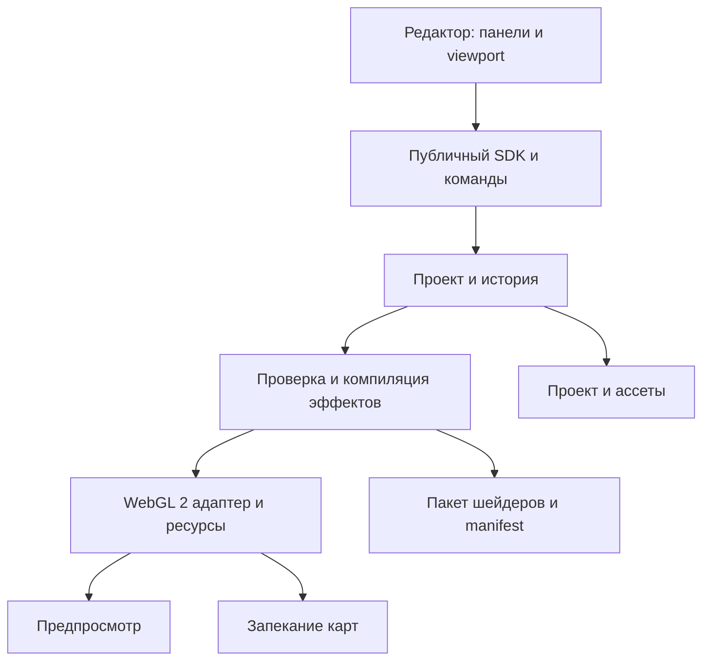

# WebGL Playground: исследование и проектирование этапа 1

Статус: проектное предложение, 28 октября 2026. Репозиторий на момент исследования пуст. Реализация и измерения на устройствах ещё не проводились; технические решения ниже необходимо подтвердить прототипом.

## Цель и границы

Открытый браузерный редактор и встраиваемый SDK для создания текстур и материалов/шейдеров без обязательного знания WebGL. На этапе 1 редактируется один прямоугольник с настраиваемой толщиной: две стороны с независимыми материалами и общий материал четырёх торцов, слои текстур, нормали, эффекты и предпросмотр. Интерфейс — приоритет и критерий приёмки; подробности в [исследовании Babylon.js и концепции интерфейса](product-ux-babylon.md). Первые художественные наборы — бумага и её старение, намокание, пятна от чая и кофе. Результат должен сохраняться и воспроизводиться, а не только отображаться на экране.

На этапе 1 нет свободного добавления/удаления вершин, других фигур, моделирования, полноценного редактора сцен и коллаборации. Графический слой и формат проекта должны позволить добавить геометрию позже. Под «всеми возможностями WebGL» здесь понимаем расширяемый инструмент, а не обещание представить в интерфейсе каждую функцию и расширение WebGL: детальный объём этапа ниже.

## Исследование и выбор инструментов

| Вариант | Возможности | Цена выбора и решение |
| --- | --- | --- |
| Three.js + WebGLRenderer | WebGL 2, сцена, материалы, render target, свои GLSL-шейдеры, текстуры и управление камерой; MIT. | Альтернатива: поддерживает также NodeMaterial и TSL; выбрать конкретный renderer и проверить совместимость. |
| Babylon.js | Движок, Node Material с редактором узлов, сборка vertex/fragment и процедурные текстуры; Apache-2.0. | Выбран для первого этапа с обязательной проверкой прототипом. Сравнимых измерений размера или скорости нет; см. [ADR-001](engine-decision.md). |
| Чистый WebGL 2 | Полный контроль состояния и шейдеров. | Слишком много инфраструктуры освещения, материалов и управления ресурсами для первого этапа. Полезен как эталон и для отдельных расширений. |

Документация: [Three.js WebGLRenderer](https://threejs.org/docs/pages/WebGLRenderer.html), [ShaderMaterial](https://threejs.org/docs/pages/ShaderMaterial.html), [render targets](https://threejs.org/manual/pages/rendertargets.html), [лицензия Three.js](https://github.com/mrdoob/three.js/blob/dev/LICENSE); [Babylon Node Material](https://doc.babylonjs.com/features/featuresDeepDive/materials/node_material/nodeMaterial), [процедурные текстуры](https://doc.babylonjs.com/features/featuresDeepDive/materials/advanced/custom_procedural_textures), [лицензия Babylon.js](https://github.com/BabylonJS/Babylon.js/blob/master/license.md).

**Предлагаемый стек:** TypeScript; Babylon.js с WebGL 2 — [выбор и ограничения](engine-decision.md); React для интерфейса; Vite для разработки и сборки; Vitest для модульных тестов; Playwright для браузерных сценариев. SDK не должен зависеть от React: UI вызывает публичные команды SDK. Узловой UI и специализированные библиотеки шума/цвета пока не подключать: решение после прототипа и проверки лицензий, размера и необходимости. Версии зависимостей закрепить при реализации и зафиксировать lockfile; текущие версии здесь намеренно не объявляются проверенными.

## Функциональные требования этапа 1

Приоритет P0 — обязательное для выпуска; P1 — после P0, но входит в целевой этап. Описанные ниже значения — проектные предложения, не результаты пользовательских исследований.

### Объект и предпросмотр

- P0: прямоугольник с размерами и отношением сторон; камера и освещение по умолчанию, сброс вида, увеличение колесом и вращение вокруг объекта правой кнопкой мыши. Это вращение **камеры**, а не изменение сохранённой трансформации объекта; отдельное численное вращение объекта — P1. Контекстное меню подавлять только над viewport. Обеспечить экранные кнопки и клавиатурную альтернативу мыши.
- P0: толщина прямоугольника задаётся числом: при нуле остаётся двусторонняя плоскость, при положительном значении появляются четыре реальные торцевые грани. Настройки торцов сохраняются при переходе через ноль; для них доступен общий материал, цвет, текстура и эффекты. Подробнее — [толщина и торцы](product-ux-babylon.md#толщина-и-торцы--обязательное-требование-p0).
- P0: независимые лицевая и обратная стороны — каждая имеет свой набор слоёв и свойства материала. Предусмотреть осознанное зеркалирование/ориентацию UV обратной стороны. При просмотре снизу текст/асимметричный тестовый рисунок должен соответствовать выбранному режиму.
- P0: базовый управляемый источник света, яркость и направление; нейтральное окружение. Карта нормалей заметна лишь при подходящем освещении и влияет на освещение, не на силуэт.
- P1: сетка сегментов плоскости для видимых vertex-деформаций без ручного редактирования вершин. Задать допустимый диапазон и бюджет треугольников после замеров. Для двух треугольников сложное искривление геометрически невозможно.

### Текстуры и материалы

- P0: загрузка локальных PNG/JPEG, однотонный цвет, процедурная основа бумаги; отдельные стеки для каждой стороны. Импортированные файлы остаются локальными. Несколько слоёв: добавить, удалить, дублировать, менять порядок, включать/отключать; прозрачность и режимы normal/multiply/screen с явно заданной формулой в линейном пространстве.
- P0: независимые UV scale/repeat, offset, rotation и pivot, clamp/repeat/mirror, min/mag filter, mipmaps, anisotropy в пределах поддержки устройства, flip Y, alpha; отображать доступность и проверять сочетания. Пропорции изображения не должны искажаться без явного действия.
- P0: настройки base color, opacity, roughness, normal map и её силы, выбор ориентации зелёного канала; roughness/normal/маски — данные без цветового преобразования, base color — sRGB по умолчанию; расчёт смешивания и освещения — в линейном пространстве, вывод — sRGB. Конкретные форматы экспорта и диапазоны валидировать.
- P1: генерация height и normal из бумажных волокон, прозрачные границы, импорт отдельных карт roughness и masks. Нормали смешивать корректно в едином tangent space, а не простым смешиванием RGB; определить соглашение tangent basis и поведение с обратной стороны в прототипе.
- P0: при ошибке импорта/загрузки, CORS, превышении размеров и нехватке GPU-ресурсов показывать причину и сохранять проект. Проверять лимиты конкретного WebGL-контекста, включая размер и число текстур. [CORS](https://developer.mozilla.org/en-US/docs/Web/HTTP/Guides/CORS); [ограничения](https://developer.mozilla.org/en-US/docs/Web/API/WebGL_API/WebGL_best_practices).

### Инструмент шейдеров и масок

- P0: понятный конструктор **стека типизированных эффектов** с параметрами и живым предпросмотром. Пользователь выбирает сторону, целевой канал материала и область: вся поверхность, градиент/прямоугольная/эллиптическая UV-маска, маска по периметру или импортированная маска. Маски имеют позицию, масштаб, поворот, инверсию и мягкость. Эффекты и маски независимо переставляются и включаются. Комбинирование маски и интенсивности определено одинаково при preview и bake.
- P0: fragment-эффекты: цвет, шум/волокна, затемнение края, пятно и кольцо. Они работают в пространстве UV и могут влиять на base color, roughness и height по явно указанным каналам. Один параметризованный эффект — не отдельный полноэкранный shader pass по умолчанию: компилятор может объединять совместимые операции или выполнять несколько проходов.
- P1: vertex-эффекты — волна/искривление на сегментированной плоскости, с амплитудой, частотой и маской в UV. Маска работает по вершинам, поэтому мелкие детали исчезают при малой сетке. Показать число сегментов и предупреждение. Деформация меняет геометрию, не текстуру; корректные нормали и обе стороны должны быть проверены.
- P1: расширенный режим с визуальными типизированными узлами для vertex и fragment, разделением стадий и проверкой совместимости соединений, инспекцией сгенерированного кода и ошибок компиляции. Набор узлов ограничен документированным каталогом; это не обещание визуально выразить любой GLSL. Встроенный Babylon NME — альтернатива собственного графа, выбор после эксперимента. Произвольный пользовательский GLSL и его импорт — будущая опция, не обязательная для P0/P1.
- P0: «край поверхности» — UV-полоса внутри периметра, а «торцы» — реальные боковые грани при положительной толщине; эти области и их эффекты различаются в интерфейсе. Рваный силуэт и геометрическое обугливание — после этапа 1. Опциональная прозрачность по краю имитирует неровность, но не создаёт торец.

### Наборы бумаги

P0: процедурная чистая бумага, состаренная бумага, влажное пятно, отдельные круговые следы чашки чая и кофе. Пресет — редактируемая композиция слоёв и эффектов, не только готовая картинка. Управление: seed, цвет, плотность/масштаб волокон, степень пожелтения, износ краёв, позиция, размер, интенсивность, неровность кольца и влажность. Повторное открытие с тем же seed и настройками должно давать визуально эквивалентный результат на той же реализации; побитовую идентичность между GPU не обещаем. Влажность моделируется через цвет и roughness и является художественной аппроксимацией, не физической симуляцией жидкости.

### Проекты и экспорт

- P0: новый проект, undo/redo для команд редактирования, локальное автосохранение с отображением статуса и явное сохранение/открытие переносимого архива: `project.json` + исходные файлы ассетов. Схема версионируется; ссылки только по внутренним ID; пропавший ассет не заменяется молча. Автосохранение не заменяет экспорт.
- P0: экспорт запечённых PNG-карт для лицевой и обратной сторон и четырёх торцов при положительной толщине: base color, при наличии normal и roughness. Для торцов — четыре именованные карты с соответствием локальным UV в manifest, без обещания бесшовности. Выбор размера (например, 512/1024/2048 при поддержке устройства); одинаковые UV, seed, параметры, цветовое пространство и согласованные версии эффектов. Для normal/roughness исключить sRGB-конверсию. Превышение лимитов — сообщение, не тихое уменьшение.
- P1: экспорт пакета для нашего runtime: версионированное описание, ресурсы, сгенерированные vertex/fragment GLSL, manifest uniforms/samplers/атрибутов и точная версия адаптера. Документировать, какие части зависят от выбранного движка и какие входы/освещение ожидаются. Редактор загрузит пакет в отдельном демонстрационном приложении. Не обещать, что GLSL без адаптации заработает в любом движке; анимация/vertex-деформации не сохраняются в статический PNG. Отдельный универсальный WebGL-хост/формат совместимости требует отдельного исследования.

## Интерфейс: базовая структура

Центр — 3D-предпросмотр, выбор лицевой/обратной стороны и торцов, виды и сброс камеры. Слева — вкладки «Материал», «Слои», «Эффекты», «Форма», «Наборы»; справа — свойства выбранного слоя/маски/материала и подсказки. Сверху — проект, undo/redo, сохранение/экспорт. Внизу или в отдельной панели — ошибки и состояние устройства. P1: режим графа; базовый режим не заставляет работать с узлами. Имена параметров понятны новичку, техническое название можно показать в подсказке. Управление клавиатурой, видимый фокус и текстовые подписи обязательны. Конкретная визуальная система и локализация будут уточнены при прототипировании; тестирование удобства является обязательной частью первого этапа. Подробные сценарии и критерии — в [концепции интерфейса](product-ux-babylon.md).

## Архитектура и контракты

- `core`: типы и версионированная схема проекта, валидация, миграции, команды и история; без DOM, Three.js и React. `AssetRef` хранит идентификатор/метаданные, не GPU-объект.
- `effects`: реестр определений эффектов, типы входов/выходов, стадия, схемы параметров, генерация GLSL, версии и лицензии пресетов. Декларативные операции/промежуточное представление — источник для preview, bake и shader-export, где это применимо. Каждый эффект явно объявляет каналы и поддерживаемые стадии. Ошибки содержат ID эффекта и исходные сведения компилятора.
- `renderer`: адаптер выбранного движка, менеджер WebGL 2, геометрия, стороны и торцы, освещение, компиляция и lifetime GPU-ресурсов; изолирует версии движка. На стартовом прототипе сравнить способы назначения материалов сторонам и торцам, проверить ориентацию UV, normal и depth/blending. Использовать единое описание геометрии; при прозрачности проверить сортировку, не обещать отсутствие артефактов. Сторону и материал моделировать отдельно; видимость обеих сторон сама по себе не назначает два разных материала.
- `baker`: offscreen render targets, вычисление карт в UV, выбор размера и проверка ресурсов. Cache invalidation по графу зависимостей; частые ползунки обновляют uniforms без повторной компиляции, изменение структуры может вызвать компиляцию. Статические слои пересчитывать только при изменениях; анимированные — по необходимости. Не рассчитывать на создание полноценной PBR-карты запеканием освещённого viewport.
- `storage`: архив и валидация лимитов/версий; целостность и атомарная загрузка, миграции. `sdk`: небольшой публичный API управления проектом, рендером, событиями, импортом/экспортом и освобождением ресурсов. Асинхронные операции возвращают ошибки; экземпляр SDK владеет своими ресурсами и освобождает их при `dispose`.
- `editor`: React-компоненты, локальное состояние интерфейса; проект и его изменения принадлежат SDK. Пакеты в монорепозитории: `packages/core`, `packages/effects`, `packages/renderer`, `packages/sdk`, `apps/editor`, при необходимости `packages/baker` и `packages/storage`.

Предлагаемая структура данных: `Project { schemaVersion, assets, geometry, materials: { front, back, edges }, environment, camera }`; материал хранит упорядоченные слои, маски, цветовые/текстурные настройки и эффекты с `type`, `version`, `params`, `seed`, `target`, `maskId`. Данные — сериализуемые значения и ID; конкретный окончательный JSON Schema будет создан при реализации. Сохранение выполняет проверку диапазонов и версий; внешние URL не считать переносимыми ассетами.

## Проверка перед выбором движка

Сделать прототип на выбранном Babylon.js с проверкой толщины, торцов, интерфейса и сохранения; если остаются риски выбора, сравнить с Three.js на тех же сценариях. Подробности — в [ADR-001](engine-decision.md) и [матрице эксперимента](product-ux-babylon.md#матрица-эксперимента-babylonjs-и-threejs). Тестовый сценарий: две разные стороны, два изображения и маска, пятно/краевая маска, tangent-space normal, один vertex-эффект на сегментированной сетке, сохранение/восстановление и bake без освещения. Проверить совпадение preview и baked base color при контролируемых условиях освещения/цветового преобразования, ориентацию обратной стороны, обработку ошибок шейдера, прозрачность и восстановление контекста. На одинаковых браузере/устройстве записать размер производственной сборки, время первого отображения, FPS при фиксированных настройках и расход ресурсов, а также сложность интеграции graph/export. Это проверка принятого ADR, а не утверждение об уже проведённых замерах.

## План разработки и критерии готовности

1. **Прототип и ADR:** проверить рискованные детали выбранного движка и схему визуального конструктора; при блокирующих проблемах пересмотреть [ADR-001](engine-decision.md). Зафиксировать устройства, тестовую сцену и версии.
2. **SDK и viewport:** пакеты, проект, WebGL 2, прямоугольник с толщиной и торцами, управление видом, две стороны, свет и обработка потери контекста.
3. **Слои и материал:** импорт, настройка UV, порядок и смешивание, нормали, тесты ориентации и цветового пространства.
4. **Эффекты и пресеты:** реестр, маски, бумага, старение, намокание, чай/кофе, воспроизводимый seed.
5. **Сохранение и bake:** история, проект с ассетами, импорт, экспорт карт. Затем расширенный граф, vertex-эффекты и экспорт пакета для runtime.
6. **Стабилизация:** браузерные тесты, ручная проверка на GPU, документация SDK и примеры встраивания, проверка происхождения и лицензий ассетов, лицензия проекта по решению владельца.

Приёмка P0: пользователь без GLSL создаёт бумагу, кладёт другое изображение на обратную сторону, добавляет отдельное кольцо кофе по маске, меняет интенсивность и UV, вращает вид правой кнопкой, сохраняет архив, открывает его в новой сессии и экспортирует карты обеих сторон и торцов при заданной толщине. После перезагрузки параметры, ассеты и вид воспроизводятся; нормаль проверяется под направленным светом. Проверить PNG на тестовом изображении, alpha и цветовое пространство, не только скачать файл. Браузерные тесты: текущие стабильные Chrome/Edge и Firefox на desktop плюс Safari при наличии тестового устройства; доступность WebGL 2 определяется фактически, а не только браузером. Добавить тесты контекстной потери через `WEBGL_lose_context`, повторного создания/удаления ресурсов и ошибок CORS/лимитов. Визуальные сравнения допускают заданный допуск для разных GPU.

Приёмка P1: на достаточно сегментированной сетке виден masked vertex-эффект; граф диагностирует несовместимые типы/стадии; экспортированный пакет запускается в отдельном приложении с заявленной версией runtime и теми же параметрами. Проверить отображение обеих сторон, деформацию и ошибки несовместимых версий. При ненулевой толщине деформация должна согласованно менять стороны и торцы без щелей.

## Риски и решения, которые ещё нужно принять

- **Составление shader + PBR:** безопасная интеграция и стабильность версии выбранного движка должны быть доказаны прототипом; не строить решение на неподтверждённых внутренних API без тестов обновления.
- **Производительность и восстановление:** render targets и многослойные карты занимают GPU-память; лимиты, качество preview, повторный расчёт и освобождение нужно измерять. Потерю WebGL-контекста обрабатывать с восстановлением из модели и исходных ассетов; известен и механизм искусственной проверки: [MDN](https://developer.mozilla.org/en-US/docs/Web/API/WEBGL_lose_context/loseContext).
- **Границы реализма:** нормали не меняют силуэт; настоящая регулируемая толщина входит в этап 1, а рваный силуэт и физическая симуляция воды — за его рамками. [Документация normal map](https://threejs.org/docs/pages/MeshNormalMaterial.html).
- **Лицензии:** библиотечные MIT/Apache лицензии не выбирают автоматически лицензию проекта. У каждого изображения, шрифта и пресета должны быть происхождение, условия использования и атрибуция. Не использовать найденные картинки без проверки.
- **Открытые решения:** лицензия проекта; приоритет узлового редактора и vertex-эффектов относительно первой версии; языки UI; поддержка мобильных устройств; целевые SDK-потребители/движки и формат экспорта. Базовая версия — desktop и наш runtime, пока требования не расширены.

## Источники и технические замечания

- [Three.js Texture](https://threejs.org/docs/pages/Texture.html): UV-трансформация, wrapping, фильтры. [Цветовое управление](https://threejs.org/manual/pages/color-management.html): для пользовательских материалов необходимо учитывать преобразование выходного пространства.
- [PlaneGeometry](https://threejs.org/docs/pages/PlaneGeometry.html): сетка сегментов. [OrbitControls](https://threejs.org/docs/pages/OrbitControls.html): вращает камеру; кнопки мыши настраиваются, правая по умолчанию отвечает за панорамирование.
- [Three.js Material](https://threejs.org/docs/pages/Material.html): front/back/double side определяют видимость граней. [Babylon Node Material](https://doc.babylonjs.com/features/featuresDeepDive/materials/node_material/nodeMaterial): визуальное создание и сборка шейдеров; самостоятельное применение его графа в нашем SDK остаётся предметом прототипа.
- В текущем Three.js WebGLRenderer использует WebGL 2; WebGL 1 не поддерживается с r163. Не переносить ограничения NPOT-текстур WebGL 1 на WebGL 2 без отдельной проверки конкретного сочетания формата и режима.
